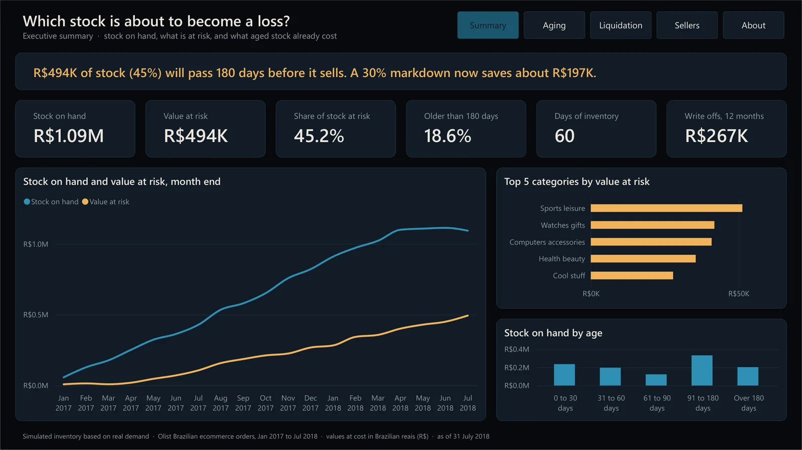
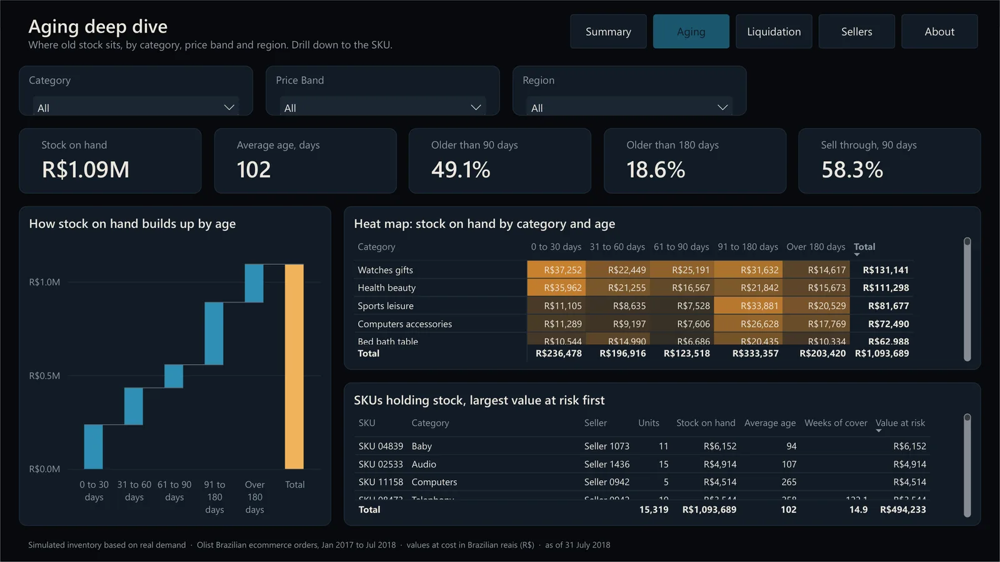
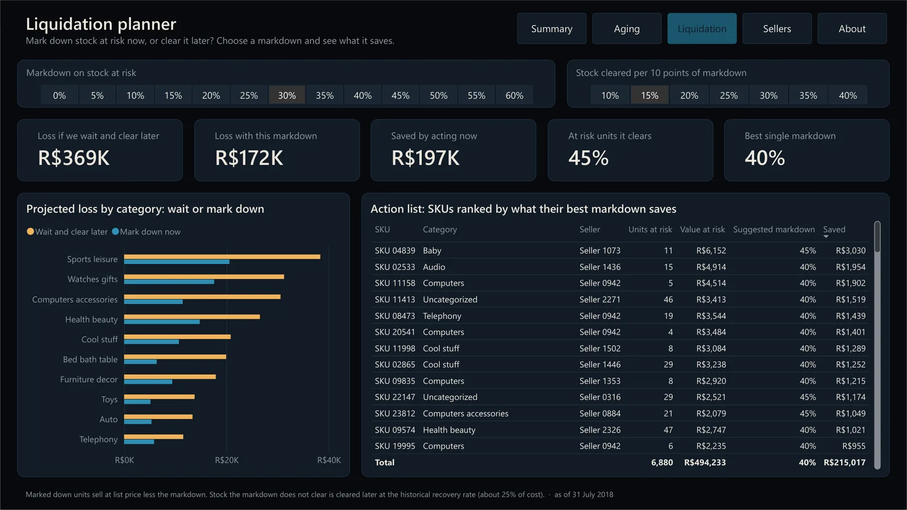
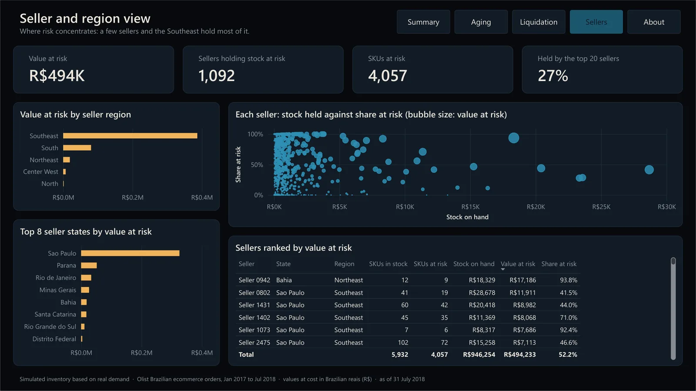
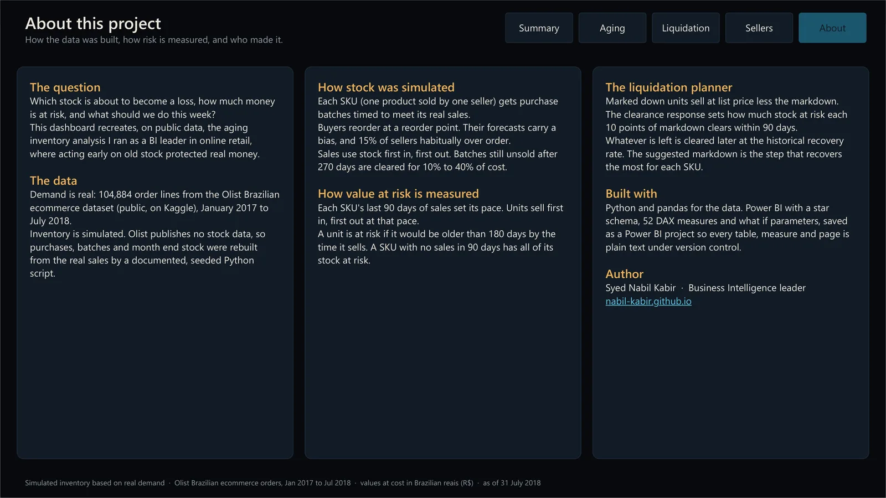

# Inventory Risk Dashboard

**Which stock is about to become a loss, how much money is at risk, and what should we do this week?**

A Power BI dashboard built on 104,884 real orders from Olist, a Brazilian marketplace. It finds the stock that will
pass 180 days before it sells, puts a price on that risk, and plans the markdown that saves the most.



* **Case study and live planner:** [nabil-kabir.github.io/projects/inventory-risk.html](https://nabil-kabir.github.io/projects/inventory-risk.html)
* **Download the dashboard:** [Inventory-Risk-Dashboard.pbix](https://github.com/nabil-kabir/inventory-risk-dashboard/releases/latest/download/Inventory-Risk-Dashboard.pbix)
  (about 10 MB, opens in the free [Power BI Desktop](https://www.microsoft.com/power-platform/products/power-bi/desktop))

## What it finds (as of 31 July 2018)

| | |
|---|---|
| Stock on hand | R$1.09M, 60 days of inventory |
| Value at risk | **R$494K**, 45% of stock value |
| Already older than 180 days | 18.6% |
| Lost to write offs in the last 12 months | R$267K |
| Saved by a 30% markdown now, versus clearing later | **R$197K** |
| Best single markdown | 40% |
| Risk held by the top 20 of 1,092 sellers | 27% |

## Five pages

| Page | What it answers |
|---|---|
| Summary | How big is the problem, is it growing, and where does it sit? |
| Aging | Which categories, price bands and SKUs hold the old stock? |
| Liquidation | What markdown saves the most, and which SKUs to act on first? |
| Sellers | Which sellers and regions concentrate the risk? |
| About | How the data was built and how risk is measured. |

|  |  |
|---|---|
|  |  |

## How it was built

**Real demand, simulated stock.** Olist publishes real orders but no inventory, so the stock is rebuilt from the
sales by a seeded, documented Python script:

* Each SKU (one product sold by one seller) gets purchase batches timed to meet its real sales.
* Buyers reorder at a reorder point; their forecasts carry a bias, and 15% of sellers habitually over order.
* Sales use stock first in, first out. Batches unsold after 270 days are cleared for 10% to 40% of cost.

**Value at risk.** Each SKU's last 90 days of sales set its pace. Units sell first in, first out at that pace, and a
unit counts as at risk if it would be older than 180 days by the time it sells.

**Liquidation planner.** Marked down units sell at list price less the markdown; a clearance response parameter sets
how much at risk stock each 10 points of markdown clears within 90 days, and the rest is cleared later at the
historical recovery rate. A DAX measure tests every markdown from 0% to 60% per SKU and keeps the one that recovers
the most.

**Model.** Star schema (snowflaked through SKU): Sales, Receipts, Stock Snapshot and Write Offs facts; SKU, Product,
Seller, Date and Aging Bucket dimensions; 52 DAX measures; two what if parameters. Saved as a Power BI project
(PBIP), so the model is plain TMDL and every report page is plain JSON, all under version control.

Full method, table list and relationships: [data/model/README.md](data/model/README.md).

## Repository

| Path | Contents |
|---|---|
| `scripts/build_model.py` | Builds the 9 model tables from the raw Olist files (Python, pandas) |
| `scripts/validate_model.py` | Integrity checks: every unit received is sold, cleared or on hand; keys resolve; no dashes in labels |
| `scripts/build_report.py` | Writes the theme and all five report pages as PBIR files |
| `Inventory Risk Dashboard.pbip` | The Power BI project (open this in Power BI Desktop) |
| `Inventory Risk Dashboard.SemanticModel/` | The model in TMDL: tables, relationships, measures |
| `Inventory Risk Dashboard.Report/` | The report pages and custom theme |
| `theme/InventoryRiskDark.json` | The dark theme, importable into any report |
| `BUILD-GUIDE.md` | Every visual's fields and exact position, for rebuilding the pages by hand |

## Rebuild it yourself

1. Download the [Olist Brazilian E-Commerce dataset](https://www.kaggle.com/datasets/olistbr/brazilian-ecommerce)
   and unzip the CSVs into `data/raw/`.
2. Build and check the model data (Python 3 with pandas):
   ```
   py scripts/build_model.py
   py scripts/validate_model.py
   ```
3. Open `Inventory Risk Dashboard.pbip` in Power BI Desktop. In **Transform data > Edit parameters**, set
   `ModelFolder` to your `data/model/` folder (with a trailing backslash), then **Refresh**.

The build is seeded, so your numbers will match the ones above exactly.

## Data and credits

Order data: [Olist Brazilian E-Commerce Public Dataset](https://www.kaggle.com/datasets/olistbr/brazilian-ecommerce)
by Olist, licensed CC BY-NC-SA 4.0. Inventory, costs and write offs are simulated from that demand and are not
real company figures. No employer data is used anywhere in this project.

Built by **Syed Nabil Kabir**, Business Intelligence leader  ·  [nabil-kabir.github.io](https://nabil-kabir.github.io)
